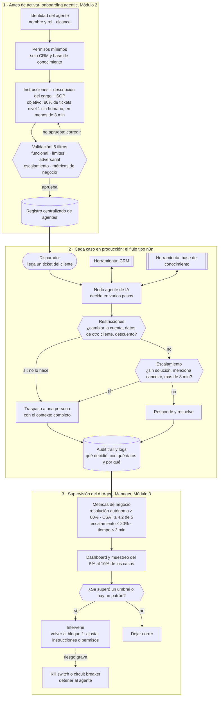
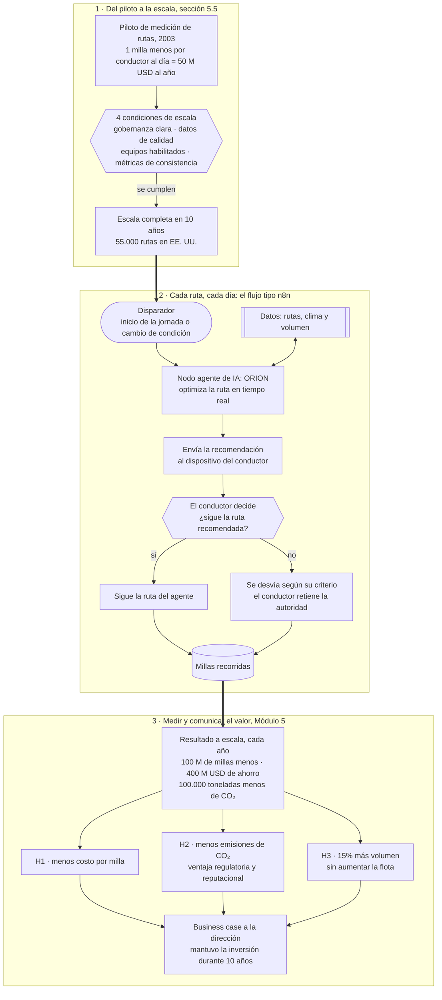

# Diagramas: AI Agent Manager (AIAM™)

Diagramas en formato Mermaid sobre los temas del curso, agregados a pedido, en el orden en que se piden. GitHub y la mayoría de los editores de Markdown los muestran dibujados; en un editor de texto plano se ve el código.

Cada diagrama indica de qué módulo y sección sale. Todo su contenido viene del curso, salvo lo que se marca explícitamente.

## Qué debe tener un sistema agentic, visto como un flujo de n8n

Muestra las piezas que el curso exige a un agente, ordenadas como si fuera un flujo de n8n, con el ejemplo del agente de soporte técnico de la sección 2.5. Sale sobre todo del Módulo 2 (secciones 2.2 a 2.7) y del Módulo 3 (secciones 3.2 a 3.5). La forma de flujo de n8n y los nombres de sus nodos no vienen en el curso: son una analogía para entenderlo.

Cómo leerlo en clave n8n: el disparador es el nodo que inicia el flujo; el agente de IA es el nodo AI Agent, con sus instrucciones como mensaje de sistema; el CRM y la base de conocimiento son sus herramientas, y no se le conecta ninguna otra, por los permisos mínimos; las restricciones y el escalamiento son nodos de condición, como IF o Switch; y el audit trail es un nodo que guarda cada ejecución. Lo que n8n no hace solo es lo de los bloques 1 y 3: diseñar, validar y supervisar, que es el trabajo del AI Agent Manager.

## Caso real UPS ORION, visto como un flujo de n8n

Muestra el caso UPS ORION de la sección 5.5: un agente que optimiza rutas de entrega, donde el agente recomienda y el conductor decide. A diferencia del ejemplo anterior, aquí el humano no interviene solo por excepción, sino en cada ruta. La forma de flujo de n8n no viene en el curso: es una analogía para entenderlo.

Cómo leerlo en clave n8n: el disparador inicia el flujo cada jornada o cuando cambian el tráfico, el clima o el volumen; el nodo de datos alimenta al agente; y el nodo de decisión no lo resuelve una máquina, sino el conductor. En n8n eso se parece a un paso que espera la respuesta de una persona. La lección del curso: el éxito de ORION no fue tecnológico, sino gerencial; la diferencia entre un piloto que muere y un sistema que genera 400 millones de dólares al año es la calidad del management, no la del algoritmo.
