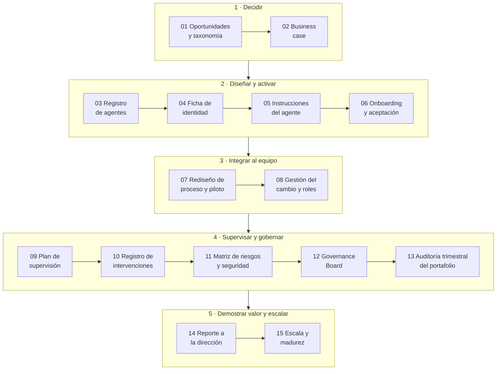

# 00 · Guía de uso de las plantillas AIAM™

Estas 15 plantillas convierten lo que enseña el curso en documentos de trabajo. Cada una explica para qué sirve, cuándo llenarla, quién la llena y la aprueba, con qué información y cómo, y trae un ejemplo lleno y los errores comunes que advierte el curso. Todo su contenido sale de `estudio/AI-Agent-Manager.md`; lo que no viene del curso está marcado como "(no viene en el curso)" o como "datos ficticios de ejemplo".

## El ciclo de vida en una mirada

Los hallazgos de la supervisión y de la auditoría trimestral (13) vuelven a la fase 2: se ajustan la ficha, las instrucciones o los permisos del agente.

## Qué plantilla usar y cuándo

| Fase | Plantilla | Cuándo se llena | Frecuencia |
|---|---|---|---|
| 1 · Decidir | 01 · Oportunidades y taxonomía | Antes de pensar en un agente: para elegir de 3 a 5 procesos candidatos y qué tareas delegar | Al inicio y cada trimestre |
| 1 · Decidir | 02 · Business case | Antes de invertir, con el baseline (cómo es el proceso hoy) medido antes del primer agente | Al inicio; se actualiza en cada fase |
| 2 · Diseñar y activar | 03 · Registro de agentes | Al aprobar un agente, antes de construirlo; nadie entra a producción sin estar aquí | Se mantiene al día siempre |
| 2 · Diseñar y activar | 04 · Ficha de identidad del agente | Antes de escribir una sola instrucción: los 6 parámetros, el nivel de autonomía y los permisos | Una por agente; se revisa al cambiar su función |
| 2 · Diseñar y activar | 05 · Instrucciones del agente | Después de la ficha: descripción del cargo más SOP (procedimiento paso a paso), en 7 componentes | Una por agente; se versiona |
| 2 · Diseñar y activar | 06 · Onboarding y aceptación | Antes de producción: las 5 dimensiones de validación | Una por agente y por cada cambio importante |
| 3 · Integrar al equipo | 07 · Rediseño de proceso y piloto | Al llevar el agente a un proceso real: AS-IS (cómo es hoy), TO-BE (cómo será), traspasos y piloto | Una por proceso |
| 3 · Integrar al equipo | 08 · Gestión del cambio y roles | En paralelo al piloto: resistencias, niveles de adopción y nuevos roles | Durante la adopción |
| 4 · Supervisar y gobernar | 09 · Plan de supervisión | Antes de producción: métricas, umbrales, muestreo y dashboard (tablero) | Se define una vez; se revisa cada trimestre |
| 4 · Supervisar y gobernar | 10 · Registro de intervenciones | Cada vez que una señal supera un umbral o se interviene un agente | Cada evento |
| 4 · Supervisar y gobernar | 11 · Matriz de riesgos y seguridad | Desde el diseño; con pruebas de límites y adversariales antes de producción | Al inicio y en cada auditoría |
| 4 · Supervisar y gobernar | 12 · Governance Board | En cada sesión del comité de gobierno | Quincenal o mensual |
| 4 · Supervisar y gobernar | 13 · Auditoría trimestral del portafolio | Revisión de todos los agentes: ¿generan valor?, ¿tienen dueño?, ¿se desviaron? | Cada trimestre |
| 5 · Demostrar valor y escalar | 14 · Reporte a la dirección | Para informar en lenguaje de negocio | Mensual en piloto, trimestral en operación estable, puntual ante incidentes |
| 5 · Demostrar valor y escalar | 15 · Evaluación de escala y madurez | Antes de pasar de piloto a escala, y para ubicar a la organización en el modelo de madurez | Antes de cada expansión |

## Cómo usarlas

1. **Haga una copia por cada caso.** Las plantillas de la 03 a la 06, la 09 y la 11 se llenan una por agente; la 07 y la 08, una por proceso; la 12 y la 13, una por sesión o trimestre. Sugerencia de nombre: `NN-tema-nombre-del-agente-AAAA-MM.md` (no viene en el curso).
2. **Siga el orden del ciclo.** Cada plantilla indica en "Se conecta con" de cuáles se alimenta y a cuáles alimenta. Por ejemplo, las métricas de éxito de la 04 se convierten en los umbrales de la 09 y en los retornos de la 02.
3. **Llene primero el baseline.** El curso insiste: sin un baseline documentado, cualquier mejora posterior es anecdótica.
4. **Use el ejemplo como guía, no como molde.** Los ejemplos usan, siempre que se puede, los casos del curso: el agente de soporte B2B (sección 2.5), Klarna, Salesforce, Accenture y UPS ORION.
5. **Mantenga vivo el registro (03).** Es la defensa principal contra el agent sprawl, la proliferación de agentes sin dueño ni métricas.

## Dos aclaraciones sobre el curso

- El curso llama al mismo órgano de dos formas: "Governance Board" (sección 3.6) y "Junta de Gobierno Agentic" (secciones 4.6 y 5.5). Las plantillas los tratan como uno solo, en la 12.
- El curso da cifras de Gartner con dos redacciones: "más del 40% de los proyectos agentic serán cancelados antes de 2027" (secciones 1.4, 3.7 y 5.1) y "el 40% de las organizaciones que pilotan agentes habrán cancelado esos proyectos para 2027" (referencia académica de la sección 5.4). Las plantillas conservan cada una donde corresponde.
