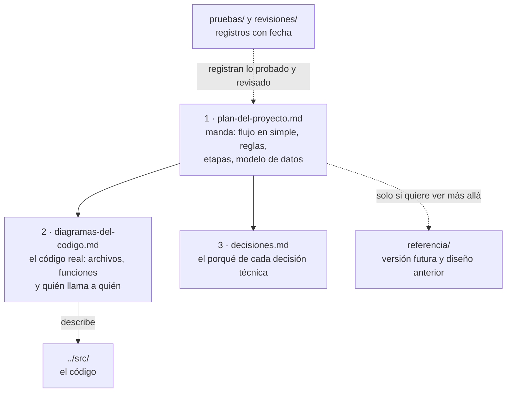

# Documentación del proyecto: por dónde empezar

Este es el mapa de `docs/`. Para entender el proyecto bastan tres documentos; el resto es referencia o registro.

| Orden | Documento | Para qué sirve | ¿Describe el código actual? |
|---|---|---|---|
| 1 | `plan-del-proyecto.md` | empiece por “El flujo completo, en simple”; tiene las reglas, las etapas y el modelo de datos, y manda sobre todo lo demás | sí |
| 2 | `diagramas-del-codigo.md` | qué archivo y qué función hace cada cosa; se actualiza al terminar cada etapa | sí |
| 3 | `decisiones.md` | por qué se eligió cada librería, cómo se guardan los vectores, las licencias, la seguridad, el modelo, la consola, FastAPI con Pydantic, por qué el tamaño del vector no se guarda en una columna y por qué el agente y los scripts de asistencia van en carpetas separadas, cómo conversa el bucle del agente con Gemini y con la base, y por qué se usa 127.0.0.1 en vez de localhost | sí |
| antes de la etapa 3 | `buenas-practicas.md` | prácticas de RAG y de agentes: cuáles ya están, cuáles se adoptan y en qué etapa, y cuáles no hacen falta | sí, es la lista vigente |
| antes de escribir pruebas | `estrategia-de-pruebas.md` | los cinco tipos de prueba (unitarias, integración, adversariales, evals y e2e): qué prueba cada uno, cuánto cuesta y cuándo se escribe | sí, es la estrategia vigente |
| antes de la etapa 5 | `evals-del-llm.md` | el plan de evaluaciones del modelo: capas, golden dataset, modelo juez y umbrales para aprobar un prompt | sí, es el plan vigente |
| antes de las etapas 5 y 6 | `pruebas-adversariales.md` | la estrategia de pruebas adversariales: las del agente, que pide el curso, y las de robustez con Hypothesis | sí, es la estrategia vigente |
| para entender el RAG | `embeddings-y-vectores.md` | qué es un embedding, por qué mide siempre 768 números, cómo influye el tamaño del fragmento, qué hacer al cambiar de modelo y cuánto cuesta calcularlos | sí |
| al cambiar de proveedor o de modelo | `proveedores-de-modelos.md` | cómo saber si un modelo acepta herramientas, cómo probar OpenRouter, Ollama, mezclar el chat y los embeddings, respaldo ante caídas y por qué no balancear | sí |
| para planificar el gasto | `costos.md` | cuánto cuesta cargar documentos y atender consultas, con escenarios de demanda y el pico de uso; cómo usar `estimar_costos.py` | sí |
| cuando haya datos reales | `anonimizacion-de-datos.md` | cómo proteger datos personales sin enviarlos fuera del equipo: técnicas, herramientas con su licencia y marcos de referencia | sí; está postergado en el plan |
| opcional | `referencia/arquitectura.md` | hacia dónde puede crecer el sistema: colas, workers, más contenedores | no, es la versión futura |
| opcional | `referencia/ruta-de-construccion.md` | cada pieza explicada con código de un diseño anterior | no, fue reemplazada por el plan |
| para repasar | `lecciones-aprendidas.md` | lo que enseñó cada etapa, en un solo lugar: el agente y el curso, el RAG, los proveedores, la base y Docker, el código y las pruebas, y Windows; cada lección remite a su detalle | sí; se agrega una lección por cada prueba o revisión que deje algo |
| registro | `pruebas/` | lo que se probó en cada etapa y qué enseñó | es historia |
| registro | `revisiones/` | las revisiones de calidad (elephant-goldfish-model y fidelidad al curso) y qué se hizo con ellas | es historia |
