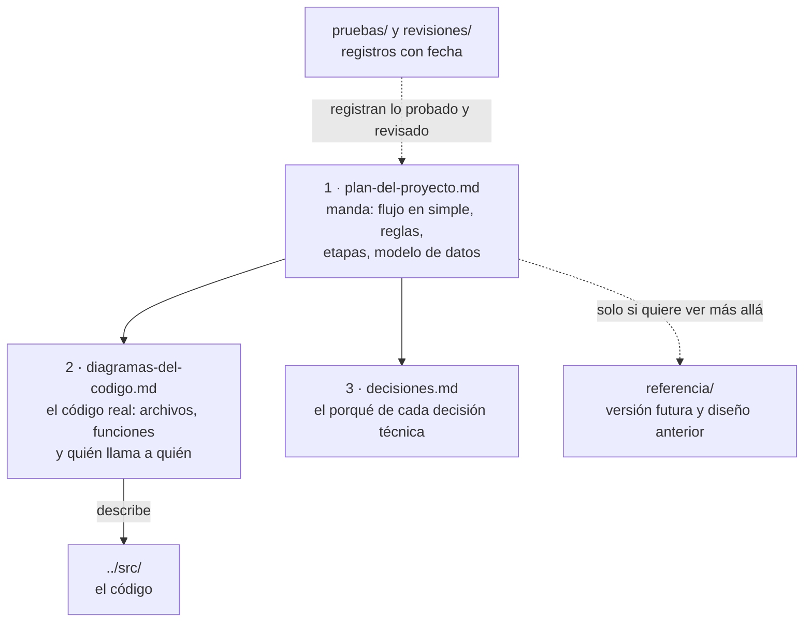

# Documentación del proyecto: por dónde empezar

Este es el mapa de `docs/`. Para entender el proyecto bastan tres documentos; el resto es referencia o registro.

| Orden | Documento | Para qué sirve | ¿Describe el código actual? |
|---|---|---|---|
| 1 | `plan-del-proyecto.md` | empiece por “El flujo completo, en simple”; tiene las reglas, las etapas y el modelo de datos, y manda sobre todo lo demás | sí |
| 2 | `diagramas-del-codigo.md` | qué archivo y qué función hace cada cosa; se actualiza al terminar cada etapa | sí |
| 3 | `decisiones.md` | por qué se eligió cada librería, cómo se guardan los vectores, las licencias, la seguridad, el modelo, la consola y FastAPI con Pydantic | sí |
| opcional | `referencia/arquitectura.md` | hacia dónde puede crecer el sistema: colas, workers, más contenedores | no, es la versión futura |
| opcional | `referencia/ruta-de-construccion.md` | cada pieza explicada con código de un diseño anterior | no, fue reemplazada por el plan |
| registro | `pruebas/` | lo que se probó en cada etapa y qué enseñó | es historia |
| registro | `revisiones/` | las revisiones de calidad (elephant-goldfish-model y fidelidad al curso) y qué se hizo con ellas | es historia |
