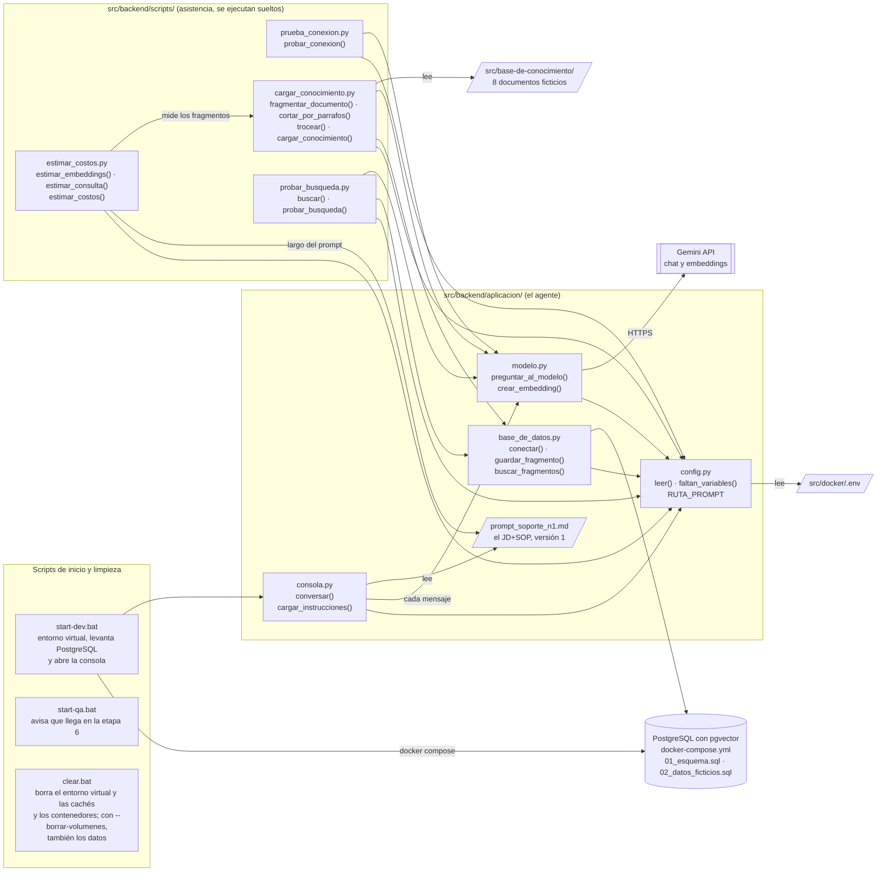
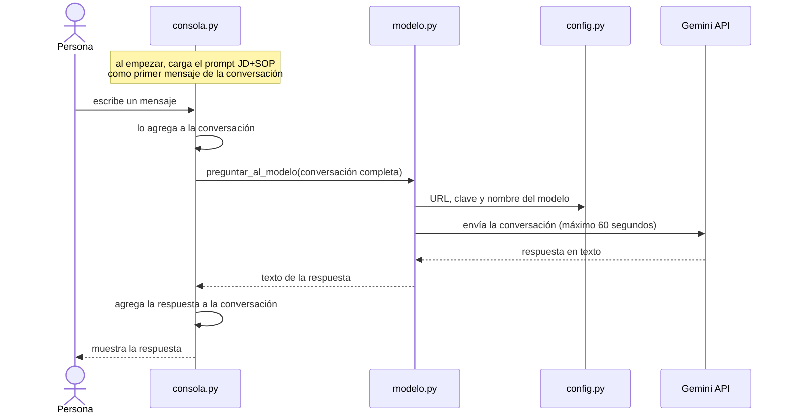
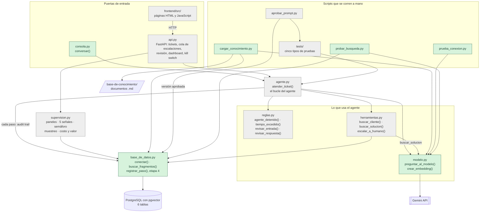
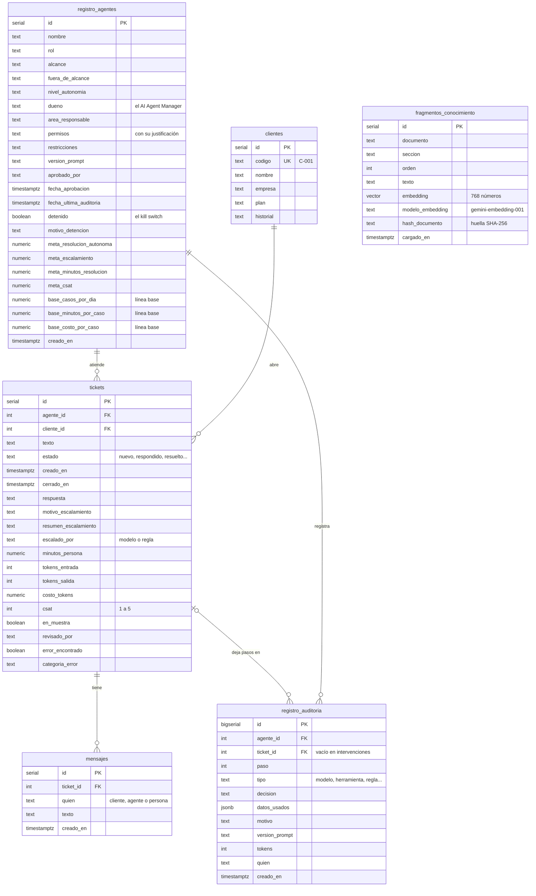
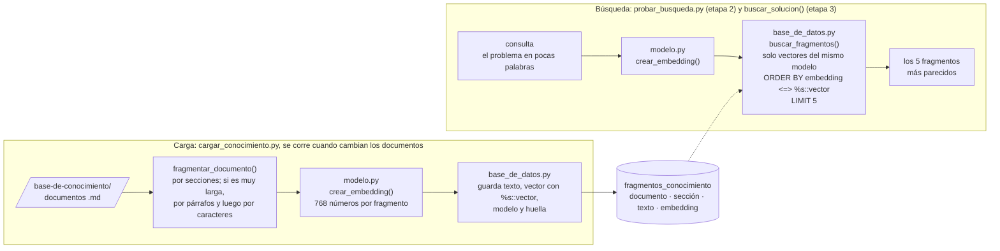

# Diagramas del código

Diagramas del código del proyecto: qué archivos y funciones existen, y quién llama a quién. A diferencia de `referencia/arquitectura.md`, que muestra el sistema completo a futuro, este archivo muestra el código real de esta versión y se actualiza al terminar cada etapa.

El proyecto no usa clases: por la regla 2 del plan (código simple de seguir), cada archivo de `src/backend/aplicacion/` y de `src/backend/scripts/` agrupa funciones sueltas sobre un mismo tema, y un archivo llama a las funciones de otro. Por eso los diagramas muestran archivos y funciones, no clases.

**Estado:** etapas 0 y 1 terminadas y probadas; etapa 2 terminada, probada por el usuario y corregida tras su revisión (2026-11-18). El 2026-11-19 el código se separó en `aplicacion/` y `scripts/` (D10) y se volvió a probar: 23 fragmentos y 7 de 7.

## 1. El código de hoy (etapas 0 a 2)

Los archivos del código de hoy, los scripts de inicio y limpieza, el `.env`, la base de datos y la conexión con Gemini. Las flechas se leen “usa a”.

El código está en dos carpetas (decisión D10): `aplicacion/` es el agente en sí, lo que entra en la imagen Docker; `scripts/` son herramientas de asistencia que se ejecutan sueltas con `python -m scripts.<nombre>` desde `src/backend`. Los scripts usan la aplicación, pero la aplicación nunca usa un script.

Qué hace cada uno, primero la aplicación y después los scripts:

- **`consola.py`**: la puerta de entrada para probar. `conversar()` lee lo que usted escribe, guarda la conversación y muestra la respuesta; `cargar_instrucciones()` lee el prompt. Todavía no usa la base de conocimiento: eso llega con las herramientas, en la etapa 3.
- **`prueba_conexion.py`** (script): `probar_conexion()` manda un saludo para comprobar la clave y el modelo.
- **`cargar_conocimiento.py`** (script, etapa 2): `fragmentar_documento()` corta cada documento por secciones; si una sección es muy larga, `cortar_por_parrafos()` la divide por párrafos, y `trocear()` corta por caracteres un párrafo demasiado largo. `cargar_conocimiento()` calcula los vectores y los guarda. Se corre cuando cambian los documentos.
- **`probar_busqueda.py`** (script, etapa 2): `buscar()` busca una consulta en la base; `probar_busqueda()` prueba una lista de consultas y dice si cada una encuentra el documento esperado.
- **`estimar_costos.py`** (script): estima, sin llamar al modelo, el costo de cargar documentos y el de cada consulta, en tres escenarios de demanda (`costos.md`).
- **`modelo.py`**: el único lugar que habla con Gemini. `preguntar_al_modelo()` conversa; `crear_embedding()` convierte textos en vectores de 768 números.
- **`base_de_datos.py`** (etapa 2): el único lugar que habla con PostgreSQL. `conectar()` abre la conexión; `guardar_fragmento()` y `buscar_fragmentos()` guardan y buscan en la base de conocimiento.
- **`config.py`**: `leer()` toma un valor del `.env`; `faltan_variables()` avisa si falta la clave, el modelo o la contraseña de la base; `RUTA_PROMPT` dice dónde está el prompt, para que la consola, la API y los scripts lo lean sin depender unos de otros.
- **`prompt_soporte_n1.md`**: no es código; es el texto que define al agente.

## 2. Qué pasa en cada mensaje de la consola

Lo importante: el modelo no recuerda nada entre mensajes. La consola le envía cada vez la conversación completa, empezando por el prompt; así el agente “recuerda” lo dicho y sigue sus instrucciones en cada respuesta.

## 3. Cómo quedará el código al terminar la versión 1 (etapa 7)

Mapa de lo que se construirá. Los archivos en verde ya existen (etapas 0 a 2); los grises son los previstos en el plan, y sus nombres de funciones pueden ajustarse al programarlos.

No se dibuja `config.py`, que ya existe, porque casi todos los archivos lo usan para leer el `.env`. Cómo leerlo: todo pasa por `agente.py`, que es el único lugar donde está el bucle del agente; la consola y la API son dos puertas hacia la misma función (decisión D6). El agente nunca habla directo con la base de datos ni con Gemini: lo hace a través de `base_de_datos.py` y `modelo.py`. `supervision.py` no atiende tickets: calcula lo que el AI Agent Manager mira en el dashboard (Módulo 3).

## 4. Modelo entidad-relación: las seis tablas

Es el esquema real de `src/docker/postgres/01_esquema.sql` (etapa 2), con todas sus columnas. `PK` es la llave primaria (el identificador de cada fila) y `FK` una llave foránea (la columna que apunta a otra tabla).

Cómo leer las relaciones:

- **Un agente atiende muchos tickets,** y **un cliente abre muchos tickets:** cada ticket guarda `agente_id` y `cliente_id`.
- **Un ticket tiene muchos mensajes:** la conversación completa, para que la persona que recibe un caso escalado vea todo.
- **El registro de auditoría** siempre apunta a un agente y casi siempre a un ticket; `ticket_id` queda vacío en las intervenciones que no son de un ticket, como detener el agente o registrar un cambio externo (por eso la línea hacia `tickets` empieza con un círculo: puede no haber ticket).
- **`fragmentos_conocimiento` no se une con ninguna tabla:** es la biblioteca del RAG, que consulta `buscar_fragmentos()`. Cada vector guarda con qué modelo se creó y de qué versión del documento viene, y la búsqueda solo compara vectores del mismo modelo (decisión D8).
- **`clientes.codigo`** es único (`UK`): es el ID que da el cliente, como `C-001`; `id` es el número interno que usan las uniones.

Qué tabla cubre qué parte del curso: `registro_agentes`, la identidad, el nivel de autonomía, el registro contra el agent sprawl, la aprobación, la línea base y el kill switch (secciones 1.2, 2.2, 2.6, 2.7 y 3.7; la 4.5 lo llama circuit breaker); `clientes`, el CRM de solo lectura (2.3); `fragmentos_conocimiento`, las soluciones documentadas (2.5); `tickets`, el escalamiento, los indicadores, el muestreo y el costo (2.5, 3.2, 3.3 y Módulo 5); `mensajes`, el traspaso con contexto (Módulo 4); y `registro_auditoria`, el audit trail y las intervenciones (Módulo 1, pregunta 9, y sección 3.4).

## 5. El RAG de la etapa 2: cargar y buscar documentos

Cómo llegan los documentos de soporte a pgvector y cómo se buscan. Es la versión 1, con `pg8000` y los vectores enviados como texto con `::vector` (decisiones D1 y D2). Se construye en la etapa 2.

En la etapa 3, esos 5 fragmentos vuelven al modelo dentro de la herramienta `buscar_solucion()`, y el agente responde solo con soluciones documentadas, como pide la sección 2.5.
