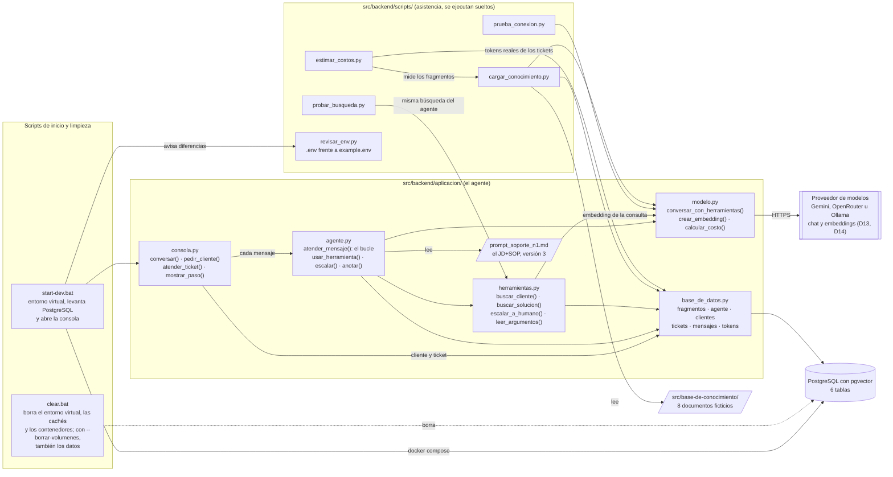
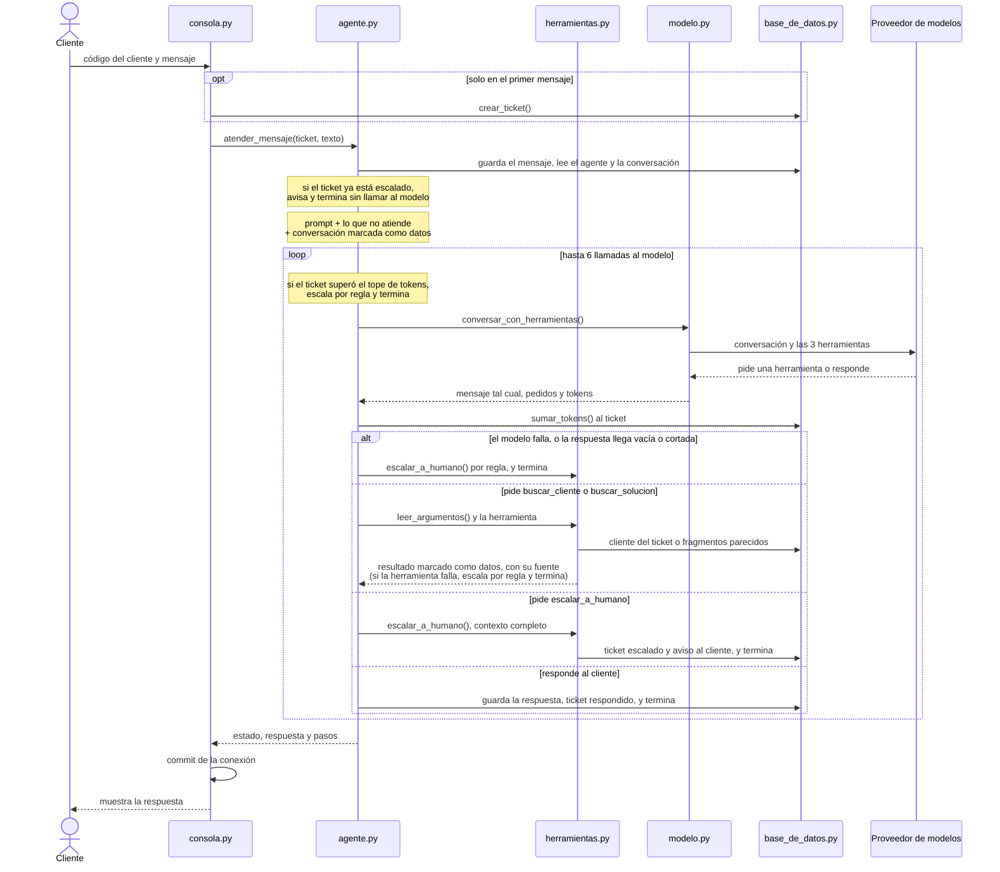
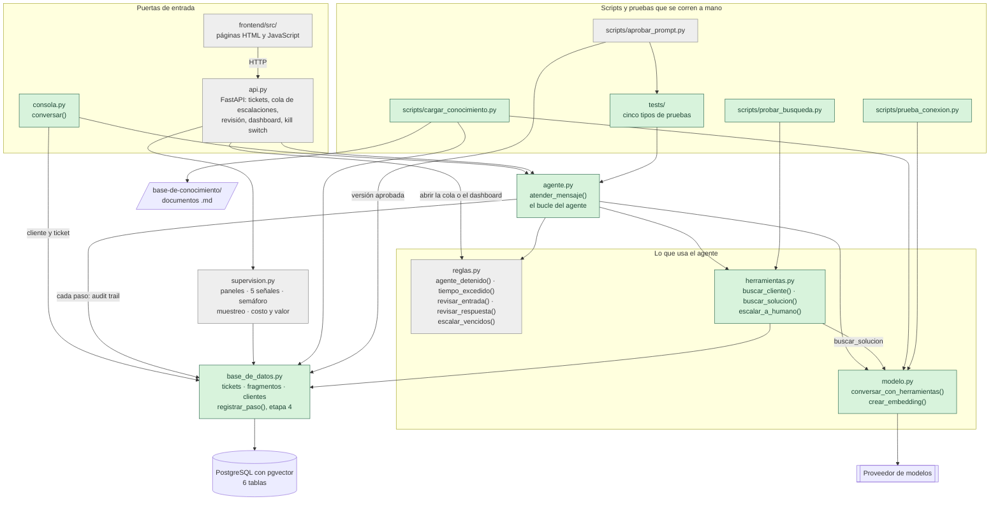
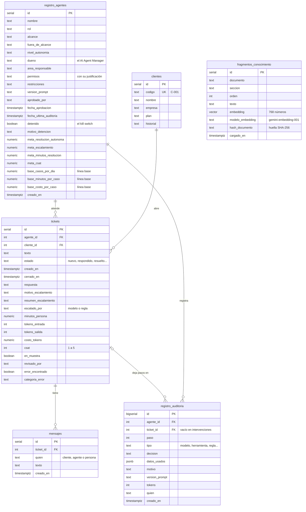
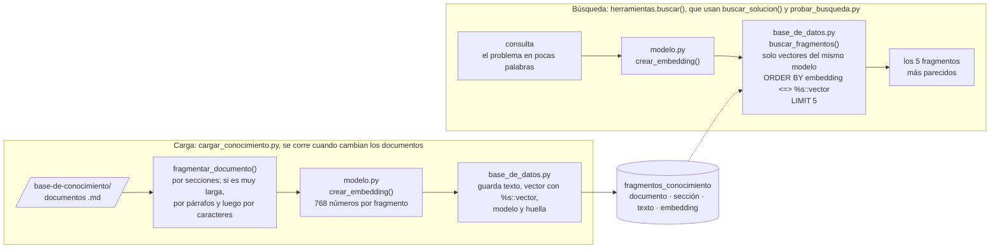

# Diagramas del código

Diagramas del código del proyecto: qué archivos y funciones existen, y quién llama a quién. A diferencia de `referencia/arquitectura.md`, que muestra el sistema completo a futuro, este archivo muestra el código real de esta versión y se actualiza al terminar cada etapa.

El código del proyecto no usa clases (las pruebas sí usan una, el modelo falso): por la regla 2 del plan (código simple de seguir), cada archivo de `src/backend/aplicacion/` y de `src/backend/scripts/` agrupa funciones sueltas sobre un mismo tema, y un archivo llama a las funciones de otro. Por eso los diagramas muestran archivos y funciones, no clases.

**Estado:** etapas 0 a 2 terminadas y probadas por el usuario. Etapa 3 (herramientas y bucle del agente) escrita y probada por el agente y aprobada por el usuario el 2026-11-19.

## 1. El código de hoy (etapas 0 a 3)

Los archivos del código de hoy, los scripts de inicio y limpieza, la base de datos y la conexión con el proveedor de modelos. Las flechas se leen “usa a”. No se dibuja `config.py`, porque casi todos los archivos lo usan para leer el `.env`.

El código está en dos carpetas (decisión D10): `aplicacion/` es el agente en sí, lo que entra en la imagen Docker; `scripts/` son herramientas de asistencia que se ejecutan sueltas con `python -m scripts.<nombre>` desde `src/backend`. Los scripts usan la aplicación, pero la aplicación nunca usa un script.

Qué hace cada uno, primero la aplicación y después los scripts:

- **`consola.py`**: la puerta de entrada para probar. `pedir_cliente()` pide el código del cliente (C-001 a C-006) y `atender_ticket()` crea el ticket con el primer mensaje, pasa cada mensaje a `agente.py` y confirma los cambios en la base (D11). Con `--detallado`, `mostrar_paso()` muestra cada paso: herramientas, fragmentos con su parecido, tokens, costo y segundos.
- **`agente.py`** (etapa 3): `atender_mensaje()` es el bucle del agente, el mismo que usará la API (D6). Todo lo de un mensaje viaja en un diccionario, el `turno` (conexión, ticket, agente, versión del prompt, pasos y herramientas usadas). `armar_instrucciones()` agrega al prompt lo que el agente no atiende, leído del registro de agentes; `armar_conversacion()` marca como datos lo que dice el cliente; `usar_herramienta()` ejecuta las dos búsquedas; `leer_version_prompt()` lee la versión de la primera línea del prompt; `anotar()` y `escalar()` son el único lugar donde, desde la etapa 4, cada paso irá al registro de auditoría, con los tipos de su tabla (`modelo`, `herramienta`, `regla`).
- **`herramientas.py`** (etapa 3): las tres herramientas y su descripción para el modelo (`DEFINICIONES`). `leer_argumentos()` rechaza herramientas desconocidas y argumentos inválidos; `buscar_solucion()` entrega los fragmentos con su fuente; `buscar_cliente()` lee solo al cliente del ticket; `escalar_a_humano()` arma el contexto completo para la persona y escribe el aviso al cliente.
- **`modelo.py`**: el único lugar que habla con el proveedor de modelos (el que diga la configuración: Gemini, OpenRouter u Ollama). `conversar_con_herramientas()` envía la conversación con las herramientas y devuelve el mensaje tal cual, lo pedido, por qué terminó (`finish_reason`) y los tokens; `calcular_costo()` pasa los tokens a dólares; `crear_embedding()` convierte textos en vectores de 768 números; `preguntar_al_modelo()` queda para la prueba de conexión.
- **`base_de_datos.py`**: el único lugar que habla con PostgreSQL. Fragmentos (`borrar_fragmentos()`, `guardar_fragmento()`, `buscar_fragmentos()`, `contar_fragmentos()`), agente (`leer_agente()`), clientes (`leer_cliente()`), tickets (`crear_ticket()`, `leer_ticket()`, `guardar_respuesta()`, `guardar_escalamiento()`, `sumar_tokens()`) y mensajes (`guardar_mensaje()`, `leer_mensajes()`). Ninguna confirma los cambios: lo hace quien llama (D11).
- **`config.py`**: `leer()` toma un valor del `.env`; `PROVEEDORES` y `datos_del_proveedor()` dan la dirección y la clave (las dos del `.env`) del proveedor elegido en `LLM_PROVEEDOR` y `LLM_EMBEDDINGS_PROVEEDOR` (D14); `faltan_variables()` avisa si falta la clave, el modelo o la contraseña de la base; `RUTA_PROMPT` dice dónde está el prompt; `TOPE_TOKENS_POR_TICKET` es el tope de tokens por ticket.
- **`prompt_soporte_n1.md`**: no es código; es el texto que define al agente. La versión 3 describe las herramientas, pide citar la fuente y no agregar pasos propios, separa los datos de las instrucciones y aclara que los 8 minutos los controla el programa, porque el modelo no mide el tiempo.
- **`prueba_conexion.py`** (script): comprueba el proveedor en uso con un saludo, un pedido de las herramientas reales del agente y un embedding de 768 números.
- **`cargar_conocimiento.py`** (script, etapa 2): corta cada documento por secciones, párrafos o caracteres, calcula los vectores y los guarda. `listar_documentos()` da la lista de documentos, que también usa `estimar_costos.py`.
- **`probar_busqueda.py`** (script, etapa 2): prueba la búsqueda con la misma función que usa `buscar_solucion()`: con un texto, muestra los fragmentos más parecidos; sin texto, recorre la lista fija y cuenta los aciertos.
- **`revisar_env.py`** (script): compara el `.env` con `example.env` y, con `--ordenar`, lo alinea conservando sus valores (D14).
- **`estimar_costos.py`** (script): estima el costo de cargar documentos y de cada consulta; si ya hay tickets, usa su costo real promedio (`modelos-y-costos.md`). La cantidad de fragmentos por búsqueda sale de `herramientas.CANTIDAD_FRAGMENTOS`, su única fuente.

## 2. Qué pasa en cada mensaje del cliente

El recorrido de un mensaje. Los bloques “alt” muestran las tres salidas posibles de cada vuelta del bucle.

Lo importante: el modelo no recuerda nada entre llamadas. El agente le envía cada vez la conversación completa, y cuando el modelo pide una herramienta, su mensaje se devuelve tal cual, con la firma de pensamiento que exige Gemini 3 (D11). El código decide lo que requiere garantías: hay solo tres herramientas, cualquier otra se rechaza, y el ticket se escala por regla si supera `TOPE_TOKENS_POR_TICKET`, si el bucle llega a 6 llamadas sin terminar, si el modelo o una herramienta fallan, o si la respuesta llega vacía, cortada o filtrada. Al cliente siempre le avisa el código, no el modelo, que el caso pasó a una persona.

## 3. Cómo quedará el código al terminar la versión 1 (etapa 7)

Mapa de lo que se construirá. Los archivos en verde ya existen (etapas 0 a 3); los grises son los previstos en el plan, y sus nombres de funciones pueden ajustarse al programarlos.

No se dibuja `config.py`, que ya existe, porque casi todos los archivos lo usan para leer el `.env`. `tests/` aparece en verde porque ya tiene las pruebas unitarias y de integración; los otros tres tipos llegan en las etapas 5 y 6. Cómo leerlo: todo pasa por `agente.py`, que es el único lugar donde está el bucle del agente; la consola y la API son dos puertas hacia la misma función (decisión D6). El agente nunca habla directo con la base de datos ni con Gemini: lo hace a través de `base_de_datos.py` y `modelo.py`. `supervision.py` no atiende tickets: calcula lo que el AI Agent Manager mira en el dashboard (Módulo 3).

## 4. Modelo entidad-relación: las seis tablas

Es el esquema real de `src/docker/postgres/01_esquema.sql` (etapa 2), con todas sus columnas. `PK` es la llave primaria (el identificador de cada fila) y `FK` una llave foránea (la columna que apunta a otra tabla).

Cómo leer las relaciones:

- **Un agente atiende muchos tickets,** y **un cliente abre muchos tickets:** cada ticket guarda `agente_id` y `cliente_id`.
- **Un ticket tiene muchos mensajes:** la conversación completa, para que la persona que recibe un caso escalado vea todo.
- **El registro de auditoría** siempre apunta a un agente y casi siempre a un ticket; `ticket_id` queda vacío en las intervenciones que no son de un ticket, como detener el agente o registrar un cambio externo (por eso la línea hacia `tickets` empieza con un círculo: puede no haber ticket).
- **`fragmentos_conocimiento` no se une con ninguna tabla:** es la biblioteca del RAG, que consulta `buscar_fragmentos()`. Cada vector guarda con qué modelo se creó y de qué versión del documento viene, y la búsqueda solo compara vectores del mismo modelo (decisión D8).
- **`clientes.codigo`** es único (`UK`): es el ID que da el cliente, como `C-001`; `id` es el número interno que usan las uniones.

Qué tabla cubre qué parte del curso: `registro_agentes`, la identidad, el nivel de autonomía, el registro contra el agent sprawl, la aprobación, la línea base y el kill switch (secciones 1.2, 2.2, 2.6, 2.7 y 3.7; la 4.5 lo llama circuit breaker); `clientes`, el CRM de solo lectura (2.3); `fragmentos_conocimiento`, las soluciones documentadas (2.5); `tickets`, el escalamiento, los indicadores, el muestreo y el costo (2.5, 3.2, 3.3 y Módulo 5); `mensajes`, el traspaso con contexto (Módulo 4); y `registro_auditoria`, el audit trail y las intervenciones (Módulo 1, pregunta 9, y sección 3.4).

## 5. El RAG: cargar y buscar documentos

Cómo llegan los documentos de soporte a pgvector y cómo se buscan. Es la versión 1, con `pg8000` y los vectores enviados como texto con `::vector` (decisiones D1 y D2). Se construye en la etapa 2.

Desde la etapa 3, esos 5 fragmentos vuelven al modelo dentro de la herramienta `buscar_solucion()`, cada uno marcado como dato y con su fuente (documento > sección), y el agente responde solo con soluciones documentadas y cita la fuente que usó, como pide la sección 2.5.
