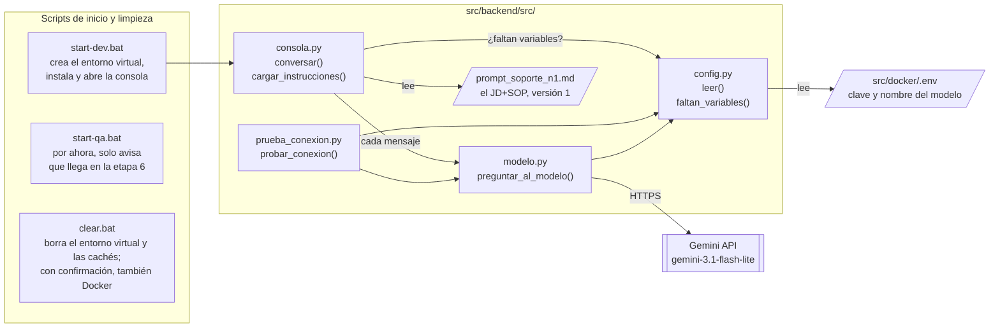
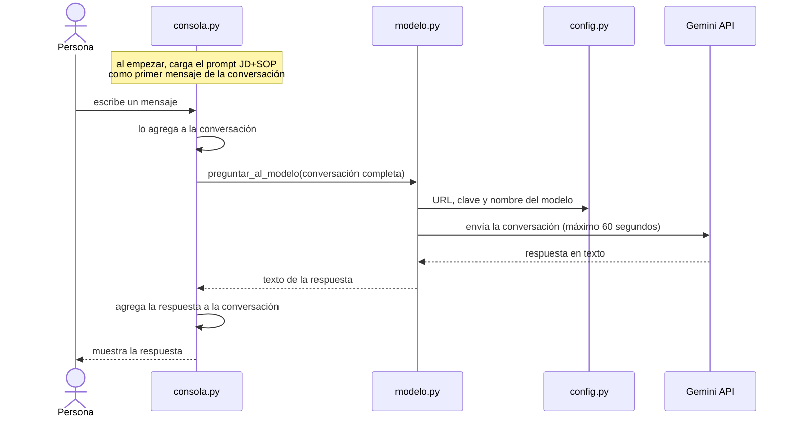
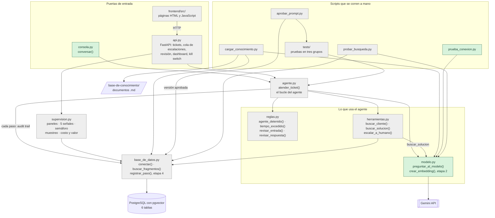
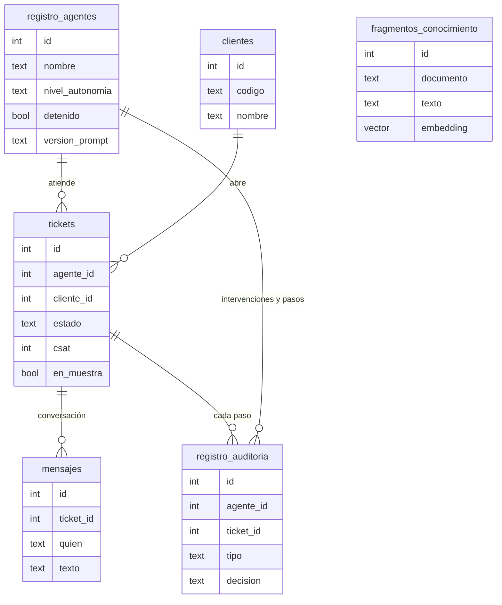
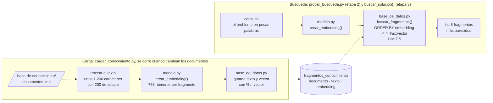

# Diagramas del código

Diagramas del código del proyecto: qué archivos y funciones existen, y quién llama a quién. A diferencia de `arquitectura.md`, que muestra el sistema completo a futuro, este archivo muestra el código real de esta versión y se actualiza al terminar cada etapa.

El proyecto no usa clases: por la regla 2 del plan (código simple de seguir), cada archivo de `src/backend/src/` agrupa funciones sueltas sobre un mismo tema, y un archivo llama a las funciones de otro. Por eso los diagramas muestran archivos y funciones, no clases.

**Estado:** etapas 0 y 1 terminadas (2026-11-18).

## 1. El código de hoy (etapas 0 y 1)

Los archivos del código de hoy, los tres scripts de inicio y limpieza, el `.env` y la conexión con Gemini. Las flechas se leen “usa a”.

Qué hace cada uno:

- **`consola.py`**: la puerta de entrada para probar. `conversar()` lee lo que usted escribe, guarda la conversación y muestra la respuesta; `cargar_instrucciones()` lee el prompt.
- **`prueba_conexion.py`**: `probar_conexion()` manda un saludo para comprobar la clave y el modelo.
- **`modelo.py`**: `preguntar_al_modelo()` es el único lugar del código que habla con Gemini.
- **`config.py`**: `leer()` toma un valor del `.env`; `faltan_variables()` avisa si falta la clave o el modelo.
- **`prompt_soporte_n1.md`**: no es código; es el texto que define al agente.

## 2. Qué pasa en cada mensaje de la consola

Lo importante: el modelo no recuerda nada entre mensajes. La consola le envía cada vez la conversación completa, empezando por el prompt; así el agente “recuerda” lo dicho y sigue sus instrucciones en cada respuesta.

## 3. Cómo quedará el código al terminar la versión 1 (etapa 7)

Mapa de lo que se construirá. Los archivos en verde ya existen; los grises son los previstos en el plan, y sus nombres de funciones pueden ajustarse al programarlos.

No se dibuja `config.py`, que ya existe, porque casi todos los archivos lo usan para leer el `.env`. Cómo leerlo: todo pasa por `agente.py`, que es el único lugar donde está el bucle del agente; la consola y la API son dos puertas hacia la misma función (decisión D6). El agente nunca habla directo con la base de datos ni con Gemini: lo hace a través de `base_de_datos.py` y `modelo.py`. `supervision.py` no atiende tickets: calcula lo que el AI Agent Manager mira en el dashboard (Módulo 3).

## 4. Los datos: las seis tablas y cómo se relacionan

Se crean en la etapa 2 (`src/docker/postgres/01_esquema.sql`). Se muestran las columnas principales y las que unen las tablas; la lista completa está en “Modelo de datos” del plan.

`fragmentos_conocimiento` no se une con las demás: es la biblioteca que consulta `buscar_solucion()` (el RAG del proyecto).

En `clientes`, `codigo` es el ID visible que da el cliente, con el formato `C-001`; `id` es el número interno que usan las uniones. En `registro_auditoria`, `ticket_id` queda vacío en las intervenciones que no son de un ticket, como detener el agente o registrar un cambio externo.

## 5. El RAG de la etapa 2: cargar y buscar documentos

Cómo llegan los documentos de soporte a pgvector y cómo se buscan. Es la versión 1, con `pg8000` y los vectores enviados como texto con `::vector` (decisiones D1 y D2). Se construye en la etapa 2.

En la etapa 3, esos 5 fragmentos vuelven al modelo dentro de la herramienta `buscar_solucion()`, y el agente responde solo con soluciones documentadas, como pide la sección 2.5.
