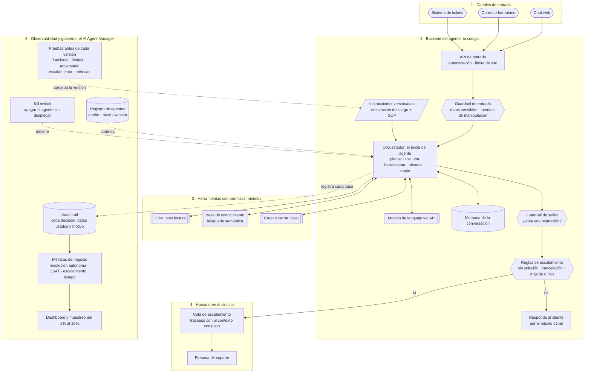
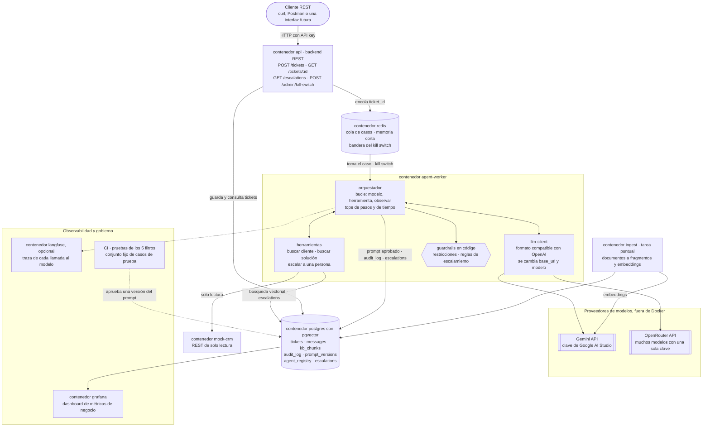
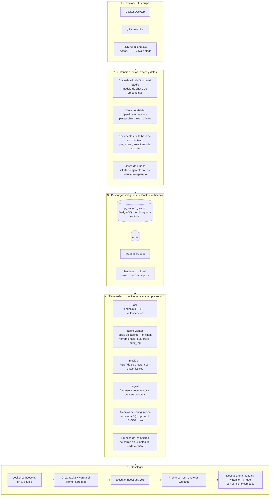
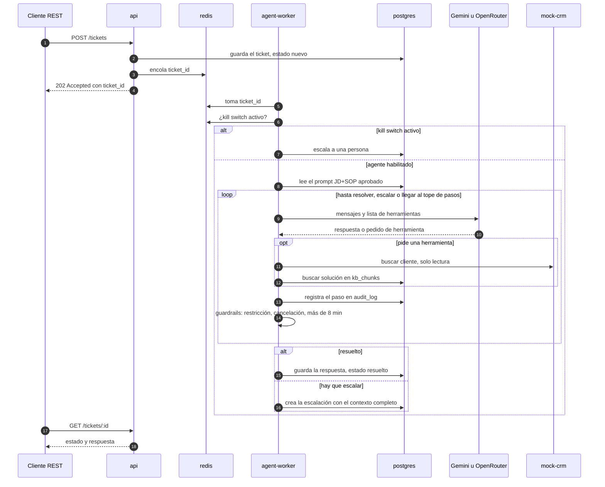

# Proyecto de agente: arquitectura del Agente de Soporte N1

Material para construir de verdad un agente de IA a partir del curso. El agente es el Agente de Soporte N1: el agente de soporte técnico B2B de la sección 2.5 del Módulo 2, el mismo que usan como ejemplo las plantillas de `estudio/plantillas/`.

Qué viene del curso y qué no: las reglas que el agente debe cumplir (identidad, permisos mínimos, instrucciones JD+SOP, restricciones, escalamiento, validación antes de producción y métricas) salen de los Módulos 2 y 3. La arquitectura técnica, los contenedores, las tecnologías y los proveedores de modelos no vienen en el curso: son una propuesta para programarlo.

Orden de lectura: primero, la arquitectura general, que muestra qué pieza técnica responde a cada exigencia del curso; segundo, la arquitectura en contenedores, desde la API REST hacia atrás; tercero, el inventario de qué se instala, se obtiene, se descarga, se programa y se despliega; y cuarto, la secuencia de un caso.

Material relacionado: el texto del system prompt (JD+SOP) y la definición de una herramienta están en `../plantillas/05-instrucciones-del-agente.md`; los diagramas de los temas del curso, en `../diagramas.md`; y el índice de todo el material, en `../indice.md`.

## Arquitectura de un proyecto de agente: el Agente de Soporte N1 llevado a código

Muestra las piezas técnicas que hacen falta para construir de verdad un agente como el de soporte técnico de la sección 2.5, y a qué exigencia del curso responde cada una. Los conceptos de gestión salen del Módulo 2 (secciones 2.2 a 2.7) y del Módulo 3 (secciones 3.2 a 3.5); la arquitectura técnica, los componentes y las tecnologías no vienen en el curso: son una propuesta para quien quiera programarlo.



Cómo leerlo: los bloques 1 a 4 son el producto que se programa, y el bloque 5 es lo que convierte ese programa en un agente gobernable, que es justamente lo que enseña el curso. El orquestador es el corazón: recibe el caso, le pasa al modelo de lenguaje las instrucciones y el contexto, y repite el ciclo de pensar, usar una herramienta y observar el resultado hasta resolver o escalar. Los permisos mínimos se implementan dándole al agente solo tres herramientas, y el CRM en modo lectura; las restricciones y el escalamiento se implementan como reglas en código, no como algo que el modelo decide solo, porque el curso dice que cuándo interviene un humano es una decisión de governance. El audit trail es una tabla o un registro donde cada paso queda guardado, y de ahí salen las métricas del dashboard. Las pruebas de los cinco filtros de validación de la sección 2.6 se vuelven pruebas automáticas que se corren antes de publicar cada versión de las instrucciones.

Con qué se puede construir (esto no viene en el curso): el orquestador se puede programar directamente con el SDK del proveedor del modelo, que existe para Python, C#, Java y Node, o con un framework de agentes como LangGraph en Python, Semantic Kernel en C# y Java, o el Vercel AI SDK en Node. La base de conocimiento usa búsqueda semántica, por ejemplo PostgreSQL con la extensión pgvector; la memoria, Redis o la misma base de datos; el audit trail, una tabla en PostgreSQL; el dashboard, Grafana o Metabase; y el kill switch, una variable de configuración o un feature flag que el orquestador revisa antes de cada caso. El CRM y el sistema de tickets pueden ser simulados al principio, con una base de datos propia.

## Arquitectura técnica en contenedores: el Agente de Soporte N1 desde la API REST hacia atrás

Versión técnica del diagrama anterior, sin los canales de entrada, que son solo interfaz: parte de la API REST y muestra los contenedores de Docker, las tablas y los proveedores de modelos, Gemini con una clave de Google AI Studio u OpenRouter. Las reglas del agente salen del Módulo 2, sección 2.5, y las métricas del Módulo 3; toda la arquitectura, los contenedores y las tecnologías no vienen en el curso.



Cómo leerlo: la API no llama al modelo directamente; guarda el ticket, lo pone en una cola de Redis y responde de inmediato, porque una llamada al modelo puede tardar varios segundos y el agente puede necesitar varias. El agent-worker toma el caso y hace el bucle: le manda al modelo el prompt aprobado, que es el documento JD+SOP guardado en la tabla prompt_versions, y las herramientas disponibles; si el modelo pide una herramienta, el worker la ejecuta y le devuelve el resultado. Las herramientas son solo tres, buscar cliente, buscar solución y escalar a una persona, y las dos primeras son de solo lectura: es el principio de permisos mínimos. El texto exacto del prompt y la definición de una herramienta están en la plantilla 05, `../plantillas/05-instrucciones-del-agente.md`. Los guardrails son código normal, no parte del prompt: revisan las restricciones y las reglas de escalamiento, como los 8 minutos o la mención de cancelación, y si corresponde dejan el caso en la tabla escalations con todo el contexto para que lo tome una persona.

Sobre los modelos: tanto Gemini como OpenRouter ofrecen un punto de acceso compatible con el formato de OpenAI, así que un solo cliente sirve para los dos y cambiar de proveedor es cambiar la URL base, la clave y el nombre del modelo en la configuración. Para la búsqueda semántica de la base de conocimiento se necesita además un modelo de embeddings, por ejemplo el de Gemini. Para el gobierno: cada paso queda en audit_log, de donde Grafana calcula la resolución autónoma, el escalamiento, el tiempo y el CSAT; la bandera del kill switch en Redis se revisa antes de cada caso y de cada paso; y una versión nueva del prompt solo se marca como aprobada si pasa en CI las pruebas de los cinco filtros de la sección 2.6.

## Inventario del Agente de Soporte N1: qué se instala, se obtiene, se descarga, se programa y se despliega

Complementa el diagrama de contenedores: separa cada componente según de dónde sale, en el orden en que conviene trabajar. Nada de esto viene en el curso; las reglas que el código debe cumplir salen del Módulo 2, secciones 2.2 a 2.6, y las métricas del Módulo 3, sección 3.2.



Cómo leerlo: lo único que se programa es el bloque 4; el resto se instala, se descarga o se configura. Instalar: Docker Desktop, git, un editor y el SDK del lenguaje elegido. Obtener: una clave gratuita de Google AI Studio alcanza para empezar con Gemini, tanto para conversar como para los embeddings; la de OpenRouter sirve para comparar otros modelos cambiando solo la configuración. También hay que reunir los documentos de soporte que formarán la base de conocimiento y un conjunto de tickets de prueba con su resultado esperado, que son la materia prima de los cinco filtros de validación de la sección 2.6. Descargar: PostgreSQL con pgvector, Redis y Grafana no se programan, se usan como imágenes de Docker; Langfuse es opcional y más pesado, porque trae varios contenedores propios.

Desarrollar son cuatro servicios pequeños. La api recibe y consulta tickets. El agent-worker es el corazón: el bucle del agente, el cliente del modelo, las tres herramientas, los guardrails y el registro de cada paso. El mock-crm simula el CRM con datos ficticios, y el ingest es una tarea que se corre una vez para cargar la base de conocimiento. Con Python, por ejemplo, serían FastAPI para la api, la librería openai apuntando a la URL de Gemini o de OpenRouter, psycopg para PostgreSQL y redis-py; en C#, ASP.NET Core y un BackgroundService; en Java, Spring Boot; y en Node, Fastify o Express con la librería openai. Desplegar es levantar todo con docker compose, crear las tablas, cargar el prompt aprobado, ejecutar el ingest y probar con curl; más adelante, el mismo archivo compose funciona en una máquina virtual en la nube.

Esqueleto del archivo docker-compose.yml, para orientarse; las claves van en un archivo .env que nunca se sube al repositorio:

```yaml
services:
  api:
    build: ./api                      # tu código
    ports: ["8000:8000"]
    env_file: .env
    depends_on: [postgres, redis]

  agent-worker:
    build: ./agent-worker             # tu código: bucle, herramientas, guardrails
    env_file: .env                    # LLM_BASE_URL, LLM_API_KEY, LLM_MODEL
    depends_on: [postgres, redis, mock-crm]

  mock-crm:
    build: ./mock-crm                 # tu código: CRM simulado

  ingest:
    build: ./ingest                   # tu código: se ejecuta una vez
    env_file: .env
    profiles: ["tareas"]              # docker compose run ingest
    depends_on: [postgres]

  postgres:
    image: pgvector/pgvector:pg16     # descargada
    environment:
      POSTGRES_PASSWORD: ${POSTGRES_PASSWORD}
    volumes: ["pgdata:/var/lib/postgresql/data", "./sql:/docker-entrypoint-initdb.d"]

  redis:
    image: redis:7-alpine             # descargada

  grafana:
    image: grafana/grafana            # descargada
    ports: ["3000:3000"]
    depends_on: [postgres]

volumes:
  pgdata:
```

Para cambiar de proveedor de modelo basta con editar el .env: con Gemini, la URL base es la de su punto de acceso compatible con OpenAI, `https://generativelanguage.googleapis.com/v1beta/openai/`; con OpenRouter, `https://openrouter.ai/api/v1`; en los dos casos se indica la clave y el nombre del modelo.

## Secuencia de un caso en el Agente de Soporte N1

Muestra, paso a paso, qué pasa entre los contenedores del diagrama anterior cuando llega un ticket. Las condiciones de escalamiento salen del Módulo 2, sección 2.5; la secuencia técnica no viene en el curso.



Cómo leerlo: el cliente recibe de inmediato un número de ticket y después consulta el resultado, o la API lo avisa con un webhook, una llamada de vuelta. Dentro del bucle, el modelo nunca toca la base de datos ni el CRM: solo pide herramientas, y el worker decide si las ejecuta. El tope de pasos evita que el agente quede dando vueltas y gastando llamadas; si se alcanza, el caso se escala.
